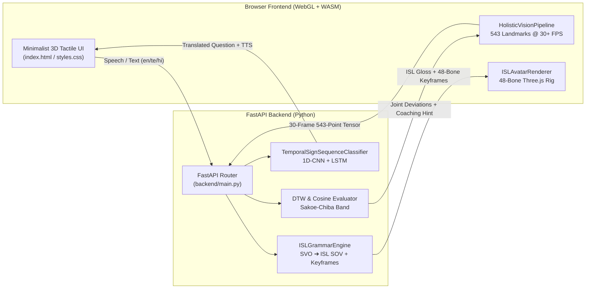

# DhwaniDrishti (`ध्वनिदृष्टि` • `ధ్వనిदृष्टि`)

[](.github/workflows/ci.yml)
[](https://www.python.org/)
[](https://fastapi.tiangolo.com)
[](LICENSE)
[](#overview)

**DhwaniDrishti** is a lightweight, real-time, bi-directional **Indian Sign Language (ISL)** translation and interactive **STEM tutoring platform** engineered for inclusive classrooms under India's **NEP 2020** accessibility mandate. It runs 100% on-device in standard Chromium/Edge/Firefox browsers alongside a zero-cloud-GPU FastAPI backend.

---

## Key Pillars & Features

### 1. LectureCast (Teacher ➔ Deaf Student)
- **Multilingual Speech & Text Input**: Supports Indian English (`en-IN`), Telugu (`te-IN`), and Hindi (`hi-IN`).
- **ISL Linguistic Engine (`backend/grammar_engine.py`)**: Converts English/Indic **Subject–Verb–Object (S-V-O)** sentences into authentic **ISL Subject–Object–Verb (S-O-V)** topological glosses with **Spatial Loci** (`IX-LEFT`, `IX-RIGHT`, `IX-CENTER`), **Non-Manual Markers (NMM)** (eyebrow raise/furrow, head tilt), and **ISLRTC STEM Lexicon** decomposition.
- **48-Bone Biomechanical 3D Avatar (`frontend/js/avatar_renderer.js`)**: Real-time WebGL/Three.js skeletal signer with articulated 5-finger hands (`ISL_HANDSHAPES`), live joint telemetry (`Wrist Roll`, `Elbow Pitch`), and 3 persona presets (*Aarav*, *Prof. Meera*, *Sheru Mascot*).

### 2. DoubtDesk (Deaf Student ➔ Teacher)
- **543-Landmark Holistic Tracking (`frontend/js/vision_pipeline.js`)**: Tracks 33 Pose, 468 Face Mesh, and 42 Left/Right Hand 3D coordinates at 30+ FPS via MediaPipe Holistic WebAssembly (with an instant deterministic 543-landmark simulator fallback when no camera is attached).
- **3D Z-Depth Volumetric Hand Rendering**: Visualizes depth-shaded skeletal bones and joints with live Z-depth proximity cues.
- **Temporal 1D-CNN + Bi-Gate LSTM Classifier (`backend/sequence_classifier.py`)**: Classifies continuous multi-frame sign trajectories into natural classroom questions and speaks them aloud using the browser's Web Speech Synthesis API (`en-IN`, `te-IN`, `hi-IN`).

### 3. ISL-STEM Coach (Interactive Biomechanical Tutor)
- **Sakoe-Chiba Dynamic Time Warping (`backend/dtw_evaluator.py`)**: Evaluates student signing trajectories for core STEM concepts (*Algorithm*, *Derivative*, *Photosynthesis*, *Momentum*, *Recursion*) against expert ISLRTC benchmarks.
- **Vector Cosine Distance & Joint Feedback**: Computes frame-warped cosine similarity (`1 - CosSim`) on wrist-to-index and elbow-to-wrist vectors, painting live **Green (aligned)** / **Red (deviated)** joint overlays and delivering actionable angle/height correction hints.

---

## Architecture



---

## Repository Structure

```text
dhwanidrishti/
├── .github/
│   └── workflows/
│       └── ci.yml                  # GitHub Actions CI across Python 3.11, 3.12, 3.13
├── backend/
│   ├── __init__.py
│   ├── main.py                     # FastAPI application, REST endpoints & static mount
│   ├── grammar_engine.py           # SVO-to-ISL SOV parser, NMM & 3D keyframe synthesizer
│   ├── dtw_evaluator.py            # Sakoe-Chiba DTW & Vector Cosine STEM evaluator
│   └── sequence_classifier.py      # Temporal 1D-CNN + LSTM sign sequence classifier
├── frontend/
│   ├── index.html                  # Accessible responsive UI with 175% spatial viewfinders
│   ├── css/
│   │   └── styles.css              # Soft 3D tactile design tokens & responsive layout
│   └── js/
│       ├── app.js                  # Main UI controller, Web Speech API & API orchestration
│       ├── avatar_renderer.js      # Three.js 48-bone 3D avatar & articulated hand signals
│       └── vision_pipeline.js      # Webcam / MediaPipe Holistic & 3D Z-depth skeleton canvas
├── tests/
│   └── test_dhwanidrishti.py       # Automated unit & FastAPI integration test suite
├── build_exe.py                    # PyInstaller one-file Windows executable builder
├── run_app.py                      # Standalone launcher (starts Uvicorn & opens browser)
├── requirements.txt                # Python dependencies
├── setup.ps1                       # Windows PowerShell one-step setup & run script
├── setup.sh                        # Linux/macOS Bash one-step setup & run script
└── LICENSE                         # MIT License
```

---

## Quick Start

### Option A: Automated Setup Script

**Windows (PowerShell):**
```powershell
.\setup.ps1
```

**Linux / macOS:**
```bash
chmod +x setup.sh
./setup.sh
```

### Option B: Manual Virtual Environment Setup

1. **Create and activate a virtual environment:**
   ```bash
   python -m venv .venv
   # Windows:
   .\.venv\Scripts\activate
   # Linux/macOS:
   source .venv/bin/activate
   ```

2. **Install dependencies:**
   ```bash
   python -m pip install -r requirements.txt
   ```

3. **Start the application:**
   ```bash
   python run_app.py
   ```
   Or with live reload during development:
   ```bash
   python -m uvicorn backend.main:app --host 127.0.0.1 --port 8000 --reload
   ```

4. Open **`http://127.0.0.1:8000`** in your browser.

---

## REST API Endpoints

| Method | Endpoint | Description |
| :--- | :--- | :--- |
| `GET` | `/api/health` | Health check and active sub-engine status |
| `POST` | `/api/lecturecast/parse` | Converts multilingual text (`en-IN`, `te-IN`, `hi-IN`) into ISL S-O-V glosses, spatial loci, NMMs, and 3D bone keyframes |
| `POST` | `/api/doubtdesk/classify` | Classifies a sequence of holistic landmark frames into an ISL question with English/Telugu/Hindi translations |
| `GET` | `/api/stem-coach/terms` | Lists supported STEM concepts (*Algorithm*, *Derivative*, *Photosynthesis*, *Momentum*, *Recursion*) and target kinematics |
| `POST` | `/api/stem-coach/evaluate` | Computes Sakoe-Chiba DTW distance, cosine similarity, per-joint status, and corrective coaching feedback |

---

## Running Tests

Execute the automated test suite covering the ISL Grammar Engine, Sakoe-Chiba DTW Evaluator, Temporal Sequence Classifier, and FastAPI endpoints:

```bash
python -m unittest discover -s tests -v
```

---

## Building a Standalone `.exe` (Windows)

You can bundle the FastAPI backend and the entire `frontend/` directory into a single portable Windows executable (`dist/DhwaniDrishti.exe`):

```bash
python -m pip install pyinstaller
python build_exe.py
```

---

## License

Distributed under the **MIT License**. See [`LICENSE`](LICENSE) for full details.

